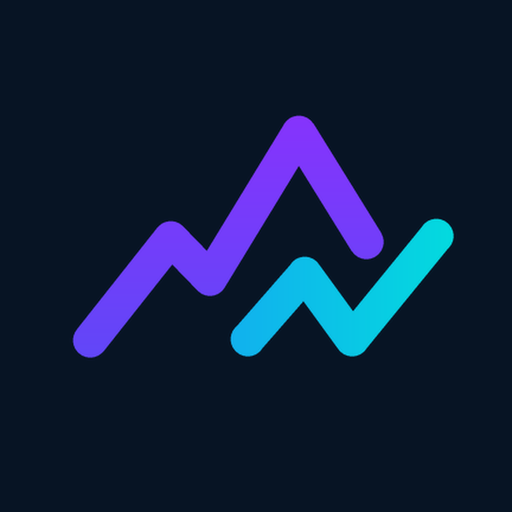
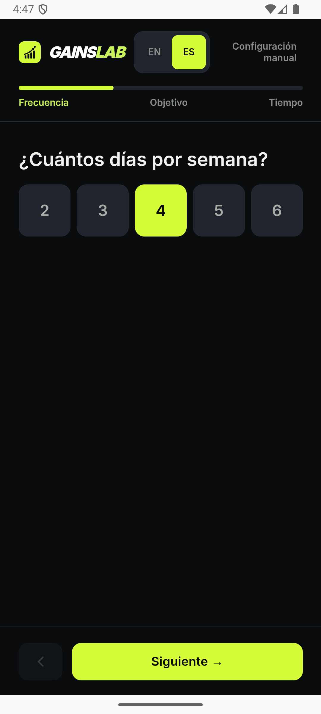
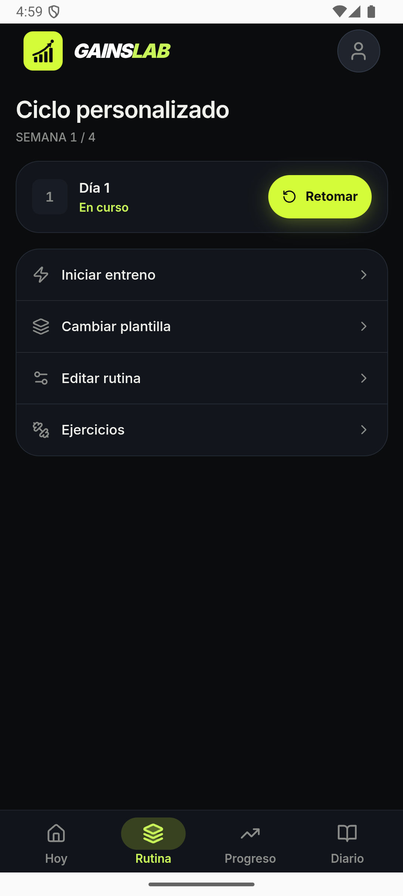
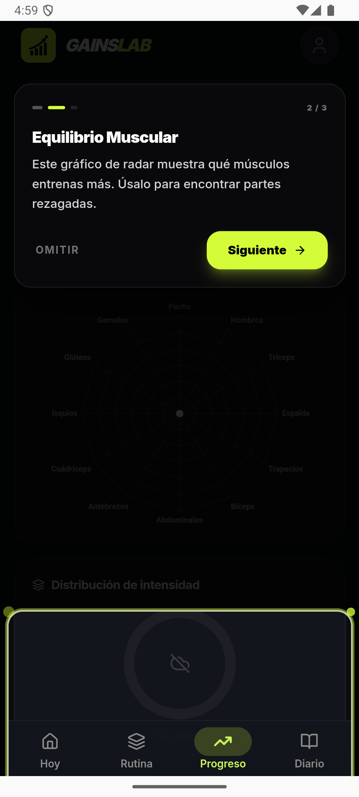

<div align="center">



# GainsLab

**El diario de entrenamiento de fuerza e hipertrofia libre, privado y sin paywalls.**  
*The free, private, open-source strength & hypertrophy workout tracker with zero paywalls.*

[](LICENSE)
[](https://github.com/gabsvm/IronLog-React/releases/latest)
[](https://github.com/gabsvm/IronLog-React/releases/latest)
[](#privacidad-y-datos)
[](#filosofía)

[**Descargar APK (Android)**](https://github.com/gabsvm/IronLog-React/releases/latest/download/GainsLab-4.0.3-kong.20.apk) • [**Instalar vía Obtanium**](#instalación-con-obtanium) • [**Ver Novedades**](https://github.com/gabsvm/IronLog-React/releases) • [**English Summary**](#english-overview)

</div>

---

## ⚡ ¿Por qué GainsLab?

Las aplicaciones populares de gimnasio (Hevy, Strong) se han vuelto cada vez más restrictivas: limitan la cantidad de rutinas gratuitas a 3 o 4, cobran suscripciones costosas (\$40–\$60/año) y bloquean estadísticas básicas tras paywalls.

**GainsLab nació con una regla inquebrantable**: Todo lo que necesitas para entrenar en serio debe ser **100% gratuito, sin anuncios y sin vender tus datos**.

### 🥊 Tabla Comparativa

| Característica | GainsLab (Open Source) | Hevy / Strong |
| :--- | :---: | :---: |
| **Precio** | **Gratis para siempre (AGPL-3.0)** | \$40 – \$60 al año |
| **Límite de Rutinas** | **Ilimitadas** | Limitadas (3–4 en plan gratis) |
| **Anuncios / Paywalls** | **Cero** | Constantes avisos "Pro" |
| **Privacidad & Offline** | **100% Local-First** (Nube opcional) | Requiere cuenta en la nube |
| **Importar Historial** | **Sí (Importador directo CSV)** | Limitado o bloqueado |
| **Superseries Inteligentes** | **Alternancia automática de foco** | Básicas o de pago |
| **Protocolos Avanzados** | **KONG, Myo-reps, RIR/RP, EMOM, Drop sets** | Rara vez disponibles |
| **Diseño** | **Expressive Dark OLED (24px)** | Estándar |

---

## 📸 Capturas de Pantalla

<div align="center">
  
  
  
  
</div>

---

## 🚀 Funcionalidades Principales

### 🏋️ Registro en Vivo de Alto Rendimiento
- **Gestión fluida de series**: Carga peso, repeticiones y RIR con un solo toque y teclado numérico adaptado.
- **Superseries con alternancia de foco**: Vincula ejercicios con un toque y la app alterna inteligentemente la serie activa entre compañeros al terminar cada serie.
- **Dock de Descanso Integrado**: Temporizador flotante con barra de progreso ondulatoria y chip con el objetivo de la próxima serie (`Set 2 · 80kg × 8`) sin recargar la vista.
- **Protocolos avanzados integrados**: Soporte nativo para Top & Back-off, Drop sets, Myo-reps, Rest-Pause, EMOM, Tabata y series isométricas/calisténicas.
- **Sobrecarga progresiva automática**: Sugerencias calculadas a partir de tu rendimiento previo en cada ejercicio.

### 📋 Rutinas y Periodización
- **Plantillas ilimitadas**: Diseña tantas divisiones como quieras (Push/Pull/Legs, Upper/Lower, Torso/Pierna, etc.).
- **Programa KONG**: Periodización de fuerza e hipertrofia lista para ejecutar.
- **Biblioteca completa de ejercicios** con clasificación por grupo muscular principal y secundario.

### 📊 Progreso y Estadísticas
- Series de trabajo semanales clasificadas por músculo con indicador de volumen óptimo (MEV/MAV/MRV).
- Cálculo de 1RM estimado y registro automático de récords personales (PRs).
- Gráficos de evolución interactivos.

### 🥗 Nutrición y Composición Corporal
- Registro diario de calorías, macronutrientes (proteínas, carbohidratos, grasas) y consumo de agua.
- Seguimiento de peso corporal, porcentaje graso y medidas con gráficos de tendencia.
- Sesiones de cardio y gasto calórico diario estimado (TDEE).

### 🔒 Privacidad y Datos (Tus datos te pertenecen)
- **Local-first**: Todo funciona completamente offline. Tu información vive en tu teléfono.
- **Migración sin fricción**: Importa tus entrenamientos previos desde **Hevy** o **Strong** mediante archivo CSV con detección automática de ejercicios.
- **Exportación total**: Descarga tu historial completo en cualquier momento en formatos CSV o JSON.
- **Sincronización en la nube opcional**: Si deseas sincronizar entre dispositivos, puedes conectar tu propia cuenta.

---

## 📲 Instalación en Android

### Opción 1: Descarga directa del APK
1. Descarga el último APK oficial desde [GitHub Releases](https://github.com/gabsvm/IronLog-React/releases/latest).
2. Abre el archivo en tu dispositivo Android y acepta instalar desde fuentes desconocidas.

### Opción 2: Instalación con Obtanium (Recomendada para actualizaciones automáticas)
Si usas [Obtanium](https://github.com/ImranR98/Obtanium):
1. Copia la URL de este repositorio: `https://github.com/gabsvm/IronLog-React`
2. En Obtanium, toca **"Add App"** y pega el enlace.
3. Obtanium descargará e instalará GainsLab, avisándote automáticamente cuando salga una nueva versión.

---

## 🛠️ Tecnologías y Desarrollo

- **Frontend**: React 18, TypeScript, Tailwind CSS, Lucide Icons.
- **Móvil**: Capacitor 8 (Android SDK 36, Target Java 21).
- **Rendimiento**: Precache PWA dividido, Virtuoso para listas infinitas, workers para cálculos pesados.
- **Calidad**: Más de 150 suites de tests automatizados (Vitest, Playwright E2E).

### Ejecutar localmente

```bash
# 1. Clonar el repositorio
git clone https://github.com/gabsvm/IronLog-React.git
cd IronLog-React

# 2. Instalar dependencias
npm install

# 3. Iniciar servidor de desarrollo
npm run dev
```

### Compilar APK Android
```bash
npm run build-android
cd android && ./gradlew assembleDebug
```

---

## 🌐 English Overview

**GainsLab** is a free, privacy-first, local-first workout tracker built for lifters who are tired of subscriptions, artificial limits, and paywalled stats.

- **Unlimited Routines & History**: No limits, no premium tiers.
- **Smart Supersets**: Seamless pairing with auto-advancing focus between paired exercises.
- **Rest Dock**: In-card rest timer that displays next target weight & reps.
- **Hevy / Strong CSV Importer**: Switch to GainsLab in seconds without losing years of past logs.
- **Offline & Private**: Stored locally on your device with optional cloud sync.
- **AGPL-3.0 Licensed**: Truly open-source and community-driven.

Download the latest APK under the [Releases](https://github.com/gabsvm/IronLog-React/releases/latest) tab.

---

## 🤝 Contribuciones y Comunidad

¡Las contribuciones son bienvenidas! Si encuentras un fallo, quieres proponer un ejercicio nuevo o sugerir una mejora:
- Abre un [Issue](https://github.com/gabsvm/IronLog-React/issues) o inicia una discusión en [Discussions](https://github.com/gabsvm/IronLog-React/discussions).
- Revisa las guías de contribución antes de enviar un Pull Request.

---

## 📜 Licencia

Distribuido bajo licencia **GNU Affero General Public License v3.0 (AGPL-3.0)**. Consulta [LICENSE](LICENSE) para más detalles.
